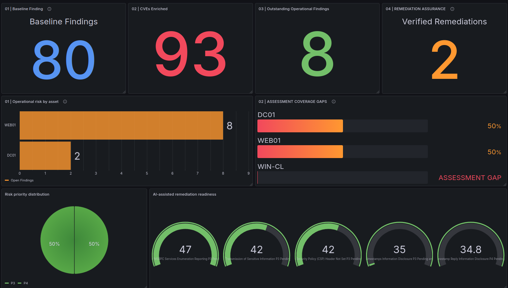
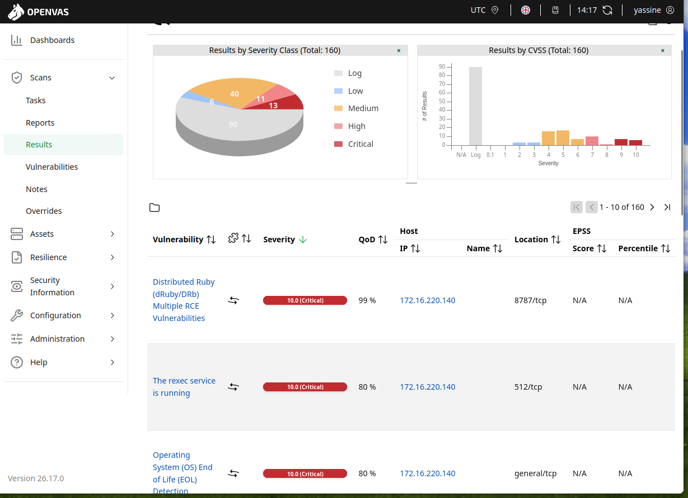
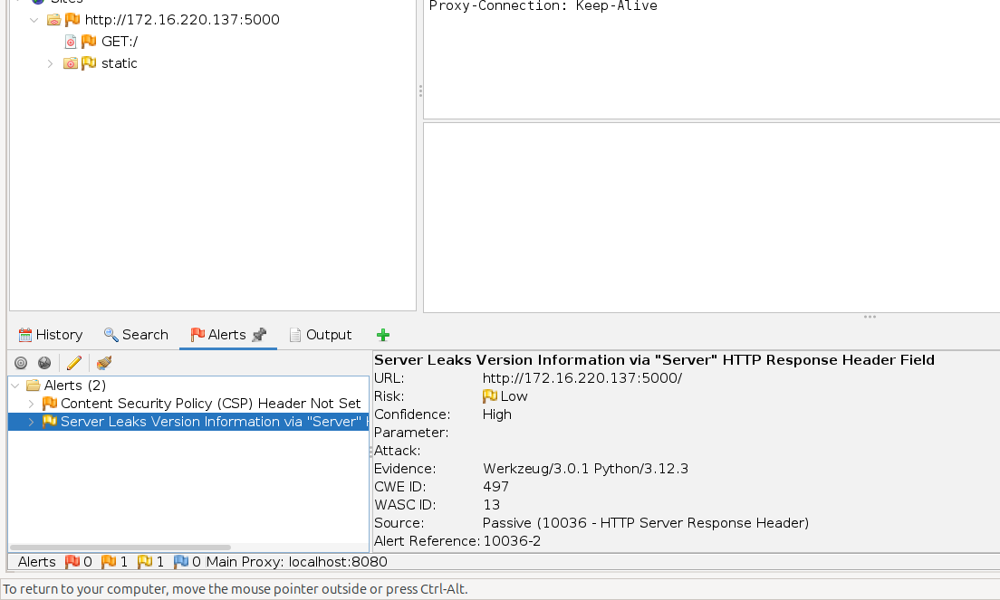
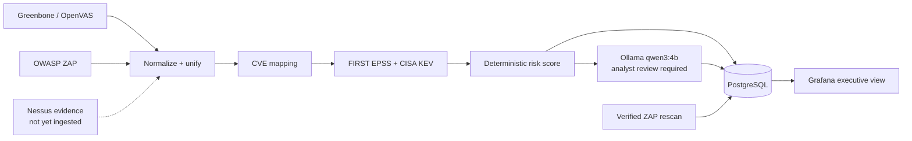

# PatchProof
### AI-assisted vulnerability management | Risk intelligence to verified remediation

**Greenbone · Nessus · OWASP ZAP · FIRST EPSS · CISA KEV · Ollama Qwen3 · PostgreSQL · Grafana**

> **Portfolio MVP — real scanner evidence, deterministic risk scoring, human-reviewed security decisions.** A VMware lab with a Windows domain controller, Windows client, Linux web application, and a deliberately vulnerable training asset. No production systems were scanned.



*Executive dashboard, linked to PostgreSQL. **Capture caveat:** the saved screenshot still shows WEB01's original eight findings in the asset bar; the remediation-aware database subsequently reported **six outstanding on WEB01 and two on DC01**. Other top-level counts reflect the verified state. Replace this image after refreshing the asset chart for a consistent final capture.*

---

## At a glance

| **80** | **93** | **125** | **2** |
|:--:|:--:|:--:|:--:|
| Scanner findings imported | Unique CVEs enriched with EPSS | CVE-to-finding associations | Verified WEB01 remediations |

**Operational backlog:** **10 → 8** imported non-training findings requiring review after two verified fixes. **10** structured local AI analyses produced, all marked *Pending analyst review*. **2** unique CISA KEV CVEs were found in the **MS2 training target**, not in currently imported operational findings.

> **Scope warning:** the 80 records are from **76 Greenbone/OpenVAS + 4 OWASP ZAP** severity-classified findings. Nessus authenticated results were captured separately but **not imported** into the dashboard. Metrics are therefore **partial and provisional**, not a complete measure of organizational risk.

## What I built

1. **Assessment and evidence:** inventoried five VMware lab assets; performed Greenbone baselines, web-app inspection with ZAP, and Nessus authenticated assessment of DC01 and WEB01.
2. **Normalization and enrichment:** joined scanner exports into a unified dataset, extracted CVE associations, queried FIRST EPSS, and checked CISA KEV membership.
3. **Transparent prioritization:** computed an explainable heuristic from scanner severity, asset criticality, EPSS, and KEV; tracked the training machine separately.
4. **Local AI assistance:** used Ollama `qwen3:4b` to draft technical risk, impact, remediation, verification and limitations as structured JSON. **AI output is not scanner evidence** and remains pending analyst validation.
5. **Executive visibility:** imported records to PostgreSQL and built a Grafana dashboard for business-oriented status and remediation progress.
6. **Verified change:** added Flask response security headers on WEB01, compared the original and updated HTTP responses, then checked a new, scoped ZAP report before recording two fixes as verified.

### Assessment evidence



*Greenbone baseline of MS2 (training only). Its 70 findings are not mixed into the operational remediation queue.*

**Scanner context:** Greenbone classified 13 critical, 11 high, 44 medium and 12 low imported findings across the lab after ZAP integration. DC01's authenticated Nessus results were richer than the Greenbone scan, but they are **not represented in the 80-record total**. See [assessment coverage](docs/assessment-coverage.md) for what is and is not measured.

### Two findings, independently rechecked

On `WEB01` (`172.16.220.137:5000`) I added:

```http
X-Content-Type-Options: nosniff
X-Frame-Options: DENY
```

The baseline ZAP report contained **Missing Anti-clickjacking Header** and **X-Content-Type-Options Header Missing**. After the change, the same tested endpoints returned the headers; the new ZAP report contained only **Missing CSP** and **Server Version Disclosure** alert types.



*Post-remediation ZAP passive alerts for the rescanned WEB01 endpoints. This confirms the two specified header findings are no longer reported for the tested requests; it does not imply the application is vulnerability-free.*

**Evidence:** [Baseline ZAP HTML](evidence/baseline/2026-10-24-ZAP-Report-.html) · [Post-remediation ZAP HTML](evidence/remediation/web01-zap-rescan.html) · [Original headers](evidence/remediation/web01-before-headers.txt) · [Updated headers](evidence/remediation/web01-after-headers.txt) · [Verification report](reports/remediation-verification.pdf).

## Architecture



All workloads ran in a local VMware NAT lab; PostgreSQL was exposed only through a host loopback port for the host-networked Grafana container.

## Repository guide

| Location | What is inside |
|---|---|
| [`scripts/`](scripts/) | Normalization, ZAP import, merging, CVE extraction, enrichment, AI analysis, PostgreSQL import and verification tracking |
| [`data/`](data/) | Machine-readable baseline and priority data (may require sanitization before publishing) |
| [`evidence/`](evidence/) | Original scanner evidence and before/after verification captures |
| [`screenshots/`](screenshots/) | Selected demonstrations, plus supplementary screenshots |
| [`diagrams/`](diagrams/) | Architecture and Grafana dashboard JSON exports |
| [`docs/`](docs/) | [Asset inventory](docs/asset-inventory.md), [Methodology](docs/prioritization.md), [coverage](docs/assessment-coverage.md), [remediation](docs/remediation-log.md), [project status](docs/project-status.md) |
| [`reports/`](reports/) | [Executive](reports/executive-summary.pdf), [technical](reports/technical-report.pdf), and [remediation verification](reports/remediation-verification.pdf) reports |

## Technical reproducibility

The ingestion pipeline is built from local Python scripts and scanner exports. Once the lab, Ollama, and PostgreSQL services are running, the core processing stages are:

```bash
/usr/bin/python3 scripts/normalize_findings.py
/usr/bin/python3 scripts/import_zap.py
/usr/bin/python3 scripts/merge_findings.py
/usr/bin/python3 scripts/extract_cves.py
/usr/bin/python3 scripts/enrich_and_prioritize.py
/usr/bin/python3 scripts/ai_analyze_findings.py
/usr/bin/python3 scripts/import_postgres.py
```

These are **workflow examples**, not a one-command lab installer. EPSS/KEV enrichment requires network access, the Ollama analysis requires the locally installed model, and running the importer requires the configured Docker PostgreSQL service. Do not rerun a later baseline over existing verified states without first preserving your snapshot / database state.

## What remains open

- **Assessment gaps:** WIN-CL credentialed Nessus authentication did not complete; imported DC01/WEB01 Nessus patch results are missing. Greenbone's empty WIN-CL export does not establish a secure endpoint.
- **Windows patch lifecycle:** WSUS installation and policy configuration were attempted, but WIN-CL did not register, and update deployment was **not verified**.
- **Training isolation:** MS2 was intentionally vulnerable and had NAT connectivity in the observed setup. Network isolation remains to be verified; no formal risk acceptance was approved.
- **Remaining WEB01 exposure:** CSP, server version disclosure, cleartext HTTP, and other findings still require assessment or remediation.
- **AI:** Generated recommendations are drafts. Some contained overclaims (for example, inferring exploitation or an access-control failure from enumeration), so they require manual checking.

The project demonstrates a **working portfolio MVP**, not 100% scanning coverage, production certification, or full remediation. See [project status](docs/project-status.md).

---

*Authorized lab only · Security outcomes backed by exported scanner findings and saved verification evidence.*
