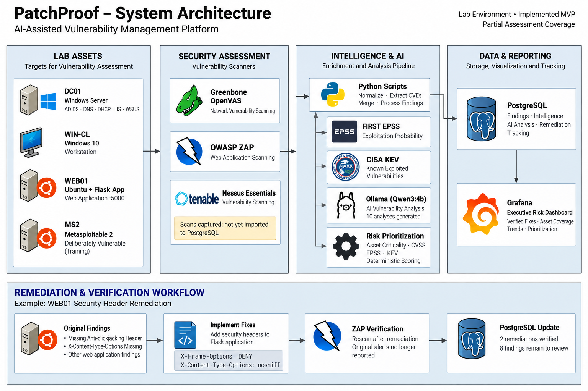
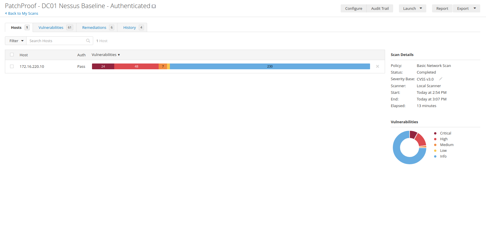
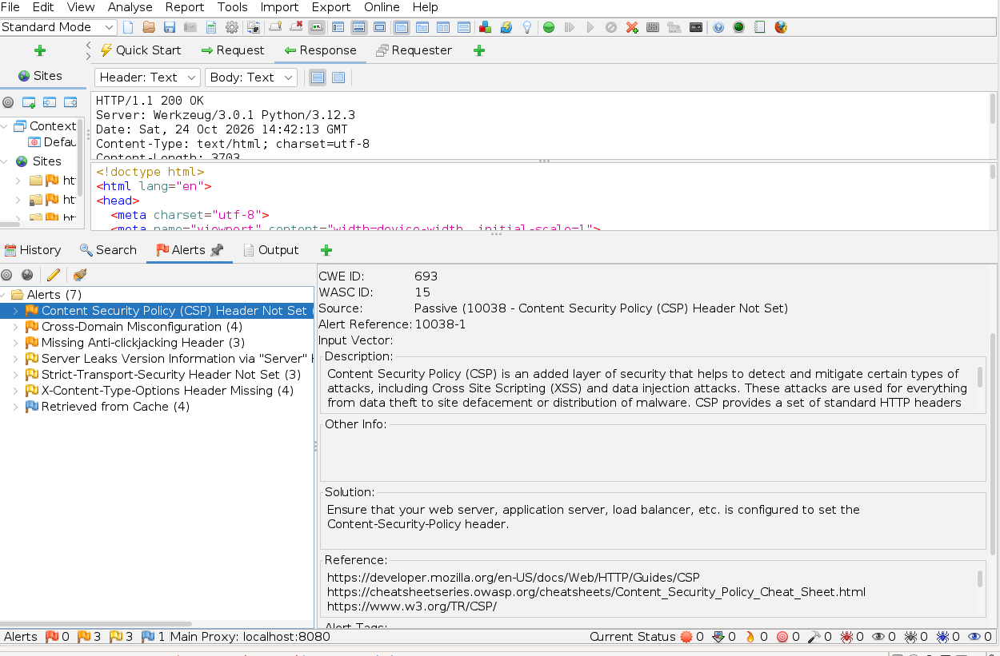
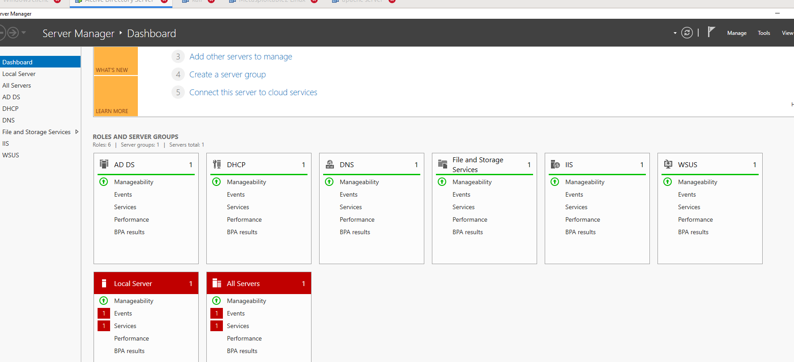
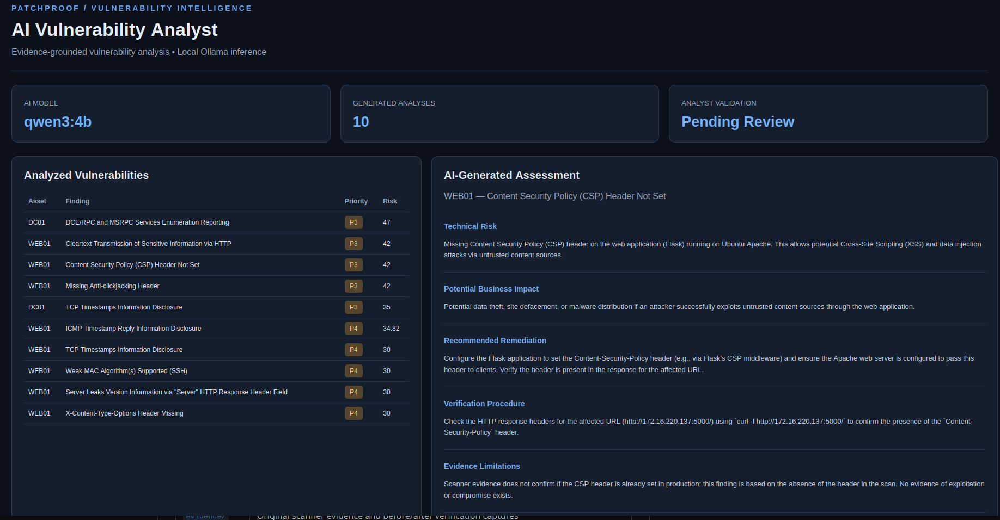

<div align="center">

# PatchProof

### AI-Assisted Vulnerability Management

**From vulnerability discovery to threat-informed prioritization and verified remediation.**

Greenbone / OpenVAS · Nessus Essentials · OWASP ZAP · FIRST EPSS · CISA KEV · Python · Ollama · PostgreSQL · Grafana

</div>

> **Portfolio MVP · Authorized VMware lab** — PatchProof is a Vulnerability Operations Center (VOC) workflow that consolidates scanner evidence, enriches CVEs, scores risk using explainable rules, drafts local AI assessments, and tracks remediation through verification.

## Executive overview


*Executive dashboard powered by PostgreSQL. At the last verified database check: **8 operational findings requiring review** and **2 verified remediations**. Screenshots may contain earlier values if captured before a panel was refreshed.*

| Imported baseline findings | Unique CVEs enriched | AI assessments generated | Verified remediations |
| :---: | :---: | :---: | :---: |
| **80** | **93** | **10** | **2** |

**What the project demonstrated:**

- Consolidated **76 Greenbone/OpenVAS** and **4 OWASP ZAP** scanner records into a unified dataset.
- Extracted **125 CVE-to-finding associations** covering **93 unique CVEs**, enriched using FIRST EPSS and CISA KEV; **2 KEV CVEs** matched the intentionally vulnerable MS2 training host.
- Built asset-aware **deterministic risk prioritization** and generated **10 local Ollama/Qwen3:4b** analyses for operational-like findings.
- Verified **two WEB01 security-header remediations** via before/after HTTP responses and a fresh ZAP assessment. Outstanding imported operational findings decreased from **10 to 8**.

> **Scope matters:** These figures cover **imported Greenbone + ZAP records**. Nessus scan evidence was collected separately but **not ingested into the database**. The intentionally vulnerable MS2 training system is excluded from operational remediation metrics.

## System architecture



**Implementation flow:** VMware lab assets → scanner exports → Python normalization / CVE extraction → EPSS and KEV enrichment → deterministic prioritization → local AI-assisted explanations → PostgreSQL → Grafana. A separate remediation evidence path feeds verified results back into PostgreSQL. Nessus is shown as an assessment tool, **not yet an integrated data source**.

## Technology and responsibilities

| Layer | Technology | Role |
| --- | --- | --- |
| Lab | VMware, Windows Server, Windows 10, Ubuntu, Metasploitable 2, Kali | Controlled assessment targets and scanning VM |
| Assessment | Greenbone/OpenVAS, OWASP ZAP, Nessus Essentials | Network and web vulnerability evidence; Nessus results remain separate |
| Data engineering | Python | Normalize, merge, correlate findings to CVEs |
| Exploit intelligence | FIRST EPSS, CISA KEV | Likelihood and known-exploitation signals |
| Prioritization | Python rules | Explainable scoring based on findings, asset context, and intelligence |
| AI | Ollama (`qwen3:4b`) | Structured technical summaries and remediation guidance, pending review |
| Storage | PostgreSQL | Findings, intelligence, AI outputs, assessments, action/verification records |
| Reporting | Grafana | Executive KPIs, exposure visualization, coverage gaps, verified fixes |

## Vulnerability assessment evidence

The laboratory includes a Windows Server domain controller (**DC01**), Windows workstation (**WIN-CL**), Ubuntu/Flask web target (**WEB01**), and deliberately vulnerable **MS2**. Kali hosts the assessment tools.

<details open>
<summary><strong>Greenbone / OpenVAS — MS2 baseline</strong></summary>


The MS2 baseline export contained **70 severity-classified findings**. This is a training target, not representative of operational risk.

</details>

<details open>
<summary><strong>Nessus Essentials — authenticated DC01 assessment</strong></summary>



Authenticated DC01 and WEB01 assessments were completed, but Nessus findings have **not** been added to the normalized PostgreSQL totals. Authenticated WIN-CL assessment remained incomplete.

</details>

<details>
<summary><strong>OWASP ZAP — WEB01 baseline findings</strong></summary>



The original WEB01 results included missing anti-clickjacking and content-type security headers. Some original ZAP alerts related to third-party domains and were excluded from the WEB01 import.

</details>

<details>
<summary><strong>Windows Server infrastructure — installed roles</strong></summary>



AD DS, DNS, DHCP, IIS, and WSUS roles were configured. **WSUS client registration and patch deployment were not verified.**

</details>

## Intelligence pipeline and risk prioritization

```text
Greenbone CSV ──┐
                ├──► Normalize / merge ──► Extract CVEs ──► FIRST EPSS + CISA KEV
ZAP HTML ───────┘                                                │
                                                                  ▼
                                                       Deterministic risk score
                                                        │                │
                                                        ▼                ▼
                                                  Ollama analysis      PostgreSQL
                                                        │                │
                                                        └────► Stored ◄──┘
                                                                         │
                                                                         ▼
                                                                       Grafana
                                                                         ▲
                                                        Verified remediation log

Nessus: separate scan evidence; ingestion is not implemented.
```

**Core scripts:** `normalize_findings.py`, `import_zap.py`, `merge_findings.py`, `extract_cves.py`, `enrich_and_prioritize.py`, `ai_analyze_findings.py`, `import_postgres.py`, and `finish_patchproof.py` in [`scripts/`](scripts/).

Priorities are **heuristic and provisional**, not proof that an asset has been fully assessed. The pipeline does not interpret missing findings as evidence of security.

## Local AI vulnerability analyst



**Ollama `qwen3:4b`** generated **10 structured analyses** from the imported operational-like findings. Each analysis contains technical risk, possible business impact, remediation, verification guidance, and evidence limitations.

The AI **does not calculate or override risk scores**. Output is retained as **pending analyst review**, and some generated claims may require correction before operational use.

[Open the generated AI evidence viewer](reports/ai-analyst-showcase.html)

## Remediation and independent verification

Two WEB01 findings were addressed in the Flask app:

```http
X-Content-Type-Options: nosniff
X-Frame-Options: DENY
```

| Finding | Finding ID | Verification | State |
| --- | --- | --- | --- |
| Missing Anti-clickjacking Header | `ZAP-c6ed5f83117c110d` | `X-Frame-Options` present; no corresponding alert in fresh ZAP results for tested URLs | **Verified** |
| X-Content-Type-Options Header Missing | `ZAP-d04e9ebd6c5df4ec` | `nosniff` present on tested HTML/CSS responses; no corresponding alert in fresh ZAP results | **Verified** |


The follow-up ZAP assessment still reported **CSP Header Not Set** and **Server Version Disclosure**. This demonstrates **two scoped fixes**, not a claim that the whole application is vulnerability-free.

**Evidence:** [Initial ZAP report](evidence/baseline/2026-10-24-ZAP-Report-.html) · [Post-remediation ZAP report](evidence/remediation/web01-zap-rescan.html) · [Response headers before](evidence/remediation/web01-before-headers.txt) · [Response headers after](evidence/remediation/web01-after-headers.txt)

**Recorded outcome:** Operational findings requiring review **10 → 8**; evidence-backed verified remediations **0 → 2**.

## Repository structure

```text
PatchProof/
├── scripts/        # Ingestion, enrichment, AI and PostgreSQL workflow
├── data/           # Normalized findings and CVE associations
├── evidence/       # Baseline scanner reports, HTTP headers and ZAP verification
├── screenshots/    # Dashboard, architecture, scan and remediation evidence
├── diagrams/       # Editable system diagrams / dashboard definitions
├── docs/           # Asset inventory and methodology
├── reports/        # Executive, technical, remediation and AI evidence
└── README.md
```

**Reproducibility:** This is a documented local pipeline, **not** a one-command installer. Running the workflow requires the lab VMs, scanner exports, access to intelligence feeds, Ollama, and the configured PostgreSQL container. No passwords or private `.env` files should be committed.

## Limitations and future work

- **Assessment gaps:** WIN-CL authenticated scanning remained incomplete. An empty Greenbone export does **not** establish security.
- **Nessus coverage:** Authenticated DC01 and WEB01 findings were reviewed but are absent from the imported totals and risk dashboard.
- **WSUS:** Role and policy configured; client registration and actual update deployment **not verified**.
- **MS2:** The intentionally vulnerable training host previously had NAT connectivity; isolation should be validated before further use.
- **Residual risk:** WEB01 still has unremediated findings; AI recommendations await human verification. The dashboard reflects imported evidence rather than a full-coverage audit.

**Status:** Completed **portfolio MVP** demonstrating evidence-backed assessment, enrichment, prioritization, local AI assistance, PostgreSQL/Grafana reporting, and **two verified WEB01 remediations**. Not a production deployment.

---

<sub>Authorized lab testing only · Findings and outcomes are limited to the exported evidence and tested endpoints.</sub>
